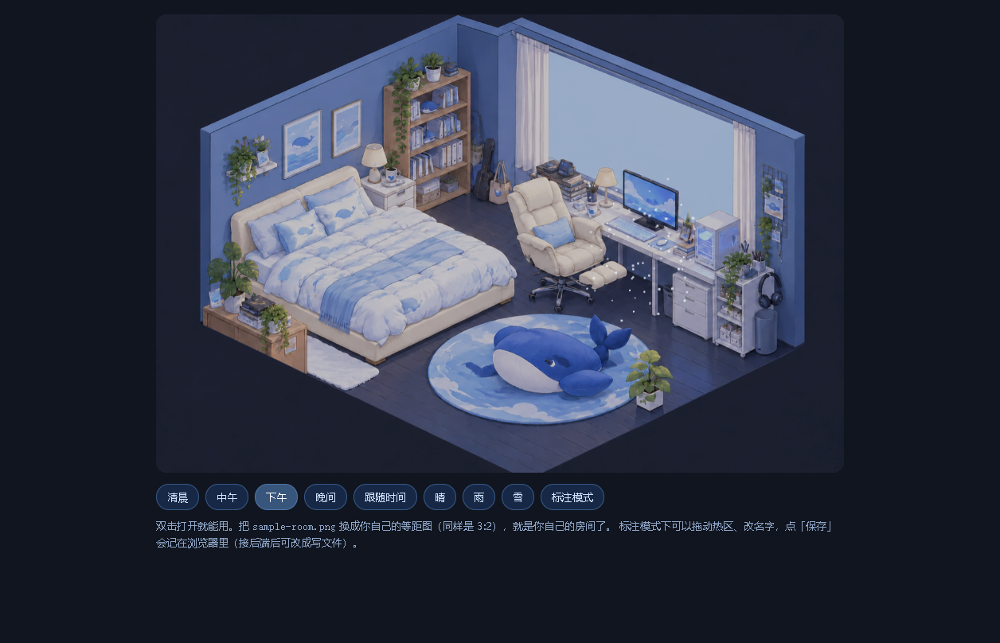

# 做一间「会过日子的房间」

一张等距插画，加上时钟、天气和几个能点的地方，就能让一个角色「住」进去。

不需要建模，不需要美术基础，一天能做完一个最小版。

## 看什么

| 文件 | 说明 |
|---|---|
| `index.html` | **攻略正文**（网页版，带目录）。直接双击打开，或者看线上版 |
| `攻略.md` | 同样内容的 Markdown，方便复制、二次编辑 |
| `模板/index.html` | **能直接跑的单文件模板**，双击就开：四时段 × 三天气、热区悬停、点击弹抽屉、标注模式 |
| `模板/sample-room.png` | 示例底图（换成你自己的等距图即可） |
| `截图/模板效果.png` | 模板跑起来长什么样 |

## 三步上手

1. 打开 `模板/index.html`，看看效果；
2. 把自己的等距房间图覆盖 `模板/sample-room.png`；
3. 打开 `模板/index.html?calib=1`（或者照攻略第 3 节）拖动热区，对到床、桌子、书架上。

## 攻略讲什么

- 先看效果、需要准备什么
- 三步做出最小版：底图 → 天色与天气 → 热区
- 三个可选升级：热区标注、灯与夜晚、让人物有状态
- 接进桌面客户端（iframe 怎么放、参数怎么传）
- 常见坑：改了像没改（缓存版本号）、坐标对不上（`getScreenCTM` 反算）、素材叠歪、换图不生效、中文文件被编辑器写坏、抽屉贴鼠标点不动
- 速通清单与文件结构

## 出处

这套做法来自「小鲸鱼房间」的实际制作过程：同一张图，白天和夜晚、晴天和雨雪，都是靠几层叠加和一点点状态切换做出来的，没有一张图是单独画的。

## 许可

随意取用、修改、再发布。
